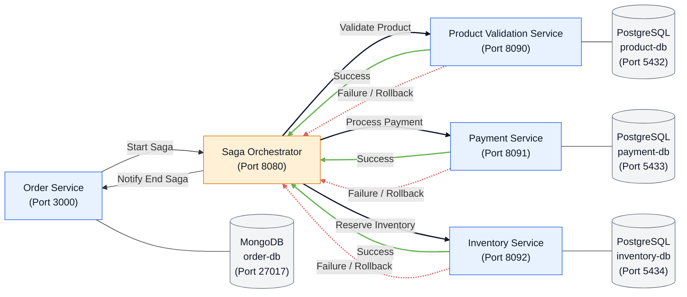

Microsserviços

1. [Introdução](#introdução)
2. [Iniciando Projeto](#iniciando-projeto)

### Introdução

- Arquitetura composta por serviços independentes e equipes autossuficientes que se comunicam por meio de APIs.
- Soluciona problemas relacionados a:
    1. Delimitação por domínio de negócio
    2. Escalabilidade e alta disponibilidade
    3. Entrega contínua (pipelines de deploy, K8s com Rolling Update ou BlueGreen)
    4. Resiliência e tolerância a falhas
- Possibilidade de utilizar diversas tecnologias, com comunicação por HTTP ou mensageria.
- São altamente testáveis. Ao contrário de um sistema monolítico, que recebe vários dados de entrada para processamento e exige a criação de mocks para os testes, nos microsserviços o fluxo é menor e mais fácil de testar.
- Redução do acoplamento entre os domínios de negócio: quanto mais acoplados forem os serviços, mais difícil será implementar novas funcionalidades. Com microsserviços, fica mais fácil observar os componentes e identificar onde implementar uma funcionalidade com baixo acoplamento.
- Implantação independente: cada parte pode ter seu próprio CI/CD e versionamento. Estratégias como rolling update garantem a atualização para uma nova versão sem causar indisponibilidade.
- Construídos com base nas especificações do domínio de negócio e mantidos por uma pequena equipe responsável.

Desafios:
- Forte necessidade de governança de TI e de equipes sincronizadas.
- Aumento da complexidade do sistema. Um monólito é um único componente, difícil de testar, mas cujo funcionamento pode ser mais fácil de entender, já que tudo está em um só lugar. Em microsserviços, é preciso acessar cada componente e verificar as entradas, as saídas, como ocorre o processamento e para onde as informações são enviadas.
- Maior número de possíveis pontos de falha, que precisam ser tratados para evitar impactos.
- Maior necessidade de métricas, observabilidade e rastreamento.

Além disso...
- Cada microsserviço possui seu próprio banco de dados. Isso é excelente para o isolamento dos serviços, porém dificulta o gerenciamento de transações distribuídas. Compartilhar o mesmo banco de dados pode causar deadlocks, nos quais uma tabela fica bloqueada por causa de uma transação em outro microsserviço. As informações podem ser replicadas em tabelas diferentes — isso é comum —, mas o ideal é que cada serviço tenha seu próprio banco de dados.
- Se a arquitetura não for devidamente planejada ou uma transação distribuída não for bem tratada, poderão ocorrer inconsistências de dados. Por exemplo, um dado pode significar A em um microsserviço X e B em um microsserviço Y. É daí que surge a necessidade do padrão Saga.
- Inconsistências de dados geralmente levam à abertura de chamados de incidentes em produção (como no cenário com a Camila, em que uma informação não está sincronizada com a outra).

Transações Distribuídas
- São transações que começam em um microsserviço, mas só são concluídas em outro de maneira `conceitual`.
    - `Conceitual` significa que a transação é apenas interpretada como uma unidade; não se trata de uma transação única no banco de dados.
    - Imagine que, em um banco de dados, temos um fluxo para atualizar uma informação, inserir um registro e excluir outro. Para isso, abrimos uma transação, executamos todas as operações e a finalizamos. Se ocorrer um erro nesse meio-tempo, toda a transação será desfeita (operação chamada de `rollback`). Suponha que a leitura e a inserção tenham sido realizadas, mas a atualização tenha falhado. A atualização não será aplicada, e a inserção será desfeita. No caso da leitura, não haverá nada a desfazer. Portanto, no banco de dados, a transação é atômica e garante a consistência: se ela inclui inserção, atualização e remoção, não é possível concluir apenas parte das operações; ou tudo é aplicado, ou nada é.
    - Portanto, no banco de dados, a transação é atômica: ou todas as alterações são aplicadas, ou todas são desfeitas para manter a consistência dos dados, seguindo os conceitos de ACID.
- Em uma arquitetura de microsserviços, cada serviço possui seu próprio banco de dados. Assim, cada chamada a um microsserviço gera uma transação interna em sua própria base.
- O conceito de transação distribuída aplica-se, então, a um `contexto` (por isso, é `conceitual` ou simbólico): um fluxo que altera o estado de vários microsserviços. Embora as operações pertençam ao mesmo contexto, elas não fazem parte de uma única transação atômica.
- Se um serviço tiver uma informação e outro não, embora ambos pertençam ao mesmo contexto, haverá uma inconsistência de dados.

Imagine o seguinte cenário:
1. Um serviço de vendas (`Order Service`) recebe uma requisição de um novo pedido e o persiste em seu banco de dados.
2. O `Order Service` envia uma requisição ou um evento ao serviço de pagamento (`Payment Service`).
3. O serviço de pagamento tenta realizar o pagamento e o persiste em sua base.
4. O serviço de pagamento envia uma requisição ou um evento ao serviço de produtos (`Product Service`) para atualizar o estoque.
5. O serviço de produtos atualiza o estoque corretamente, e o fluxo de venda é finalizado.
```
      realiza pagamento   Atualiza o estoque
Order Service → Payment Service → Product Service
       ↓               ↓                ↓
   Persiste DB      Persiste DB        Persiste DB
```

Vamos supor agora um cenário com falhas:

1. Suponha que ocorra um erro na tentativa de atualização do estoque, seja por um bug no código, por uma falha nas requisições HTTP ou pela indisponibilidade do message broker, entre outras causas.
2. O fluxo não foi concluído: temos um pedido em aberto e uma tentativa de pagamento realizada, mas o estoque está incorreto. Ou seja, temos dados inconsistentes.
3. É possível criar fluxos para cancelar o pagamento, mas e se houver várias transações anteriores?

```
      realiza pagamento   Atualiza o estoque
Order Service → Payment Service ❌ Product Service
       ↓               ↓                ↓
   Persiste DB      Persiste DB        Persiste DB
```

Diante desse cenário, temos:
1. Qual seria a estratégia necessária para desfazer todo o fluxo e evitar dados inconsistentes?
    - R: A estratégia seria implementar padrões nesses microsserviços para manter a consistência dos dados ao longo do fluxo, tanto no avanço quanto em eventuais compensações.
2. Como garantir que uma transação será sempre atômica, se cada microsserviço é independente e não tem conhecimento para executar o rollback em outras bases de dados?
    - R: Existem padrões, mas é difícil garantir isso em 100% dos casos.
3. Além de garantir a atomicidade, como manter a escalabilidade em uma arquitetura composta por vários serviços sem utilizar 2PC (Two-Phase Commit Protocol) no fluxo?
    - Esse protocolo é `síncrono` e realiza um commit em duas fases: na primeira, valida a conexão com todos os serviços via HTTP; na segunda, se todos estiverem disponíveis, realiza a persistência em todos eles. O problema é que, se a comunicação falhar nesse meio-tempo, os dados poderão ficar inconsistentes em algum serviço.
4. Por que todo esse trabalho? Como dados inconsistentes podem influenciar ou impactar o dia a dia?
    - R: A abertura de chamados porque os valores estão diferentes em bases distintas é um problema que pode se agravar.

Como tratar esses problemas?
- Existem padrões de arquitetura de microsserviços que podem ser implementados para evitar inconsistências de dados em transações distribuídas:
    - Saga orquestrado
    - Saga coreografado
    - Padrão Outbox

Saga
- É um padrão que visa coordenar a execução de um fluxo. Em caso de falha, as alterações são compensadas na ordem necessária para reverter os efeitos já realizados.
- Sua implementação é complexa, mas ajuda a tratar inconsistências de dados entre serviços. A lição é: devo utilizar o padrão Saga em todo microsserviço? Não. Ele deve ser usado apenas nos fluxos que exigem esse tipo de coordenação, como pagamentos e atualização de estoque, nos quais inconsistências precisam ser tratadas. Tenha cuidado, pois esse padrão aumenta bastante a complexidade.
- Não utiliza a estratégia 2PC (Two-Phase Commit) e, diferentemente dela, funciona de maneira `assíncrona`.
    - Ou seja, o Saga não pergunta a cada serviço se ele pode executar a operação antes de iniciar o fluxo. Ele envia a requisição ao próximo serviço e aguarda o resultado. Se houver sucesso, a requisição é enviada ao serviço seguinte; se houver falha, são acionadas as ações de compensação necessárias.
- Orquestrado
    - Utiliza um orquestrador, ou seja, um agente externo responsável por determinar a ordem de envio dos eventos com base nos casos de sucesso e falha.
    - Nessa estratégia, apenas o orquestrador precisa conhecer a ordem em que os serviços serão executados, de acordo com as respostas recebidas. Os microsserviços envolvidos devem ser independentes e não precisam conhecer o passo anterior ou o seguinte. Na imagem abaixo, não há nenhuma relação direta (→) entre os serviços Product Validation, Payment Service e Inventory.
    ```
            Start Saga           ↗ Product Validation Service
    Order Service ⇄ Orchestrator → Payment Service
           Notify End Saga       ↘ Inventory Service
    ```
    - Se houver uma falha no Inventory Service, o serviço de inventário retornará uma mensagem de erro ao orquestrador, que notificará os serviços Product Validation e Payment para que compensem as operações.
    - Em resumo, cada microsserviço terá dois tipos de chamada:
        1. Uma chamada para informar ao orquestrador o resultado da operação.
        2. Uma chamada para solicitar ou iniciar a compensação em caso de falha.
    - Quando utilizar esse modelo de arquitetura? Ele pode ser adequado quando já existe uma arquitetura de microsserviços com vários serviços implementados e sem Saga. Implantar a abordagem coreografada em uma arquitetura existente pode ser mais complexo, pois será necessário alterar o mecanismo atual e executar os testes correspondentes. Na abordagem orquestrada, os serviços existentes podem ser mantidos, adicionando-se as chamadas de sucesso e de compensação. `O orquestrador deve coordenar a compensação das operações em caso de falha`.
    - Vantagens:
        - Toda a lógica do Saga fica centralizada. Isso facilita o gerenciamento e pode reduzir falhas na coordenação dos eventos.
        - Maior testabilidade dos fluxos: há um número reduzido de interações a serem testadas.
        - Os microsserviços envolvidos não precisam conhecer os detalhes da orquestração, o que facilita a implementação e a compreensão de cada serviço.
        - Pode ser uma opção para arquiteturas existentes e fluxos com muitas transações distribuídas.
    - Desvantagem:
        - Apesar de a lógica ficar centralizada, ainda é necessário acompanhar o fluxo e manter os logs.
        - O microsserviço de orquestração pode se tornar um gargalo. Se ficar indisponível, todo o fluxo poderá ser interrompido.

- Coreografado
    - Consiste em uma coreografia entre os microsserviços: cada serviço contém a lógica para decidir o próximo passo do fluxo com base no resultado da etapa atual, seja ele sucesso ou falha.
    ```
    Order Service → Product Validation Service ⇄ Payment Service ⇄ Inventory Service
          ↑     ←   ←   ←   ←   ← Notify End Saga ←     ←   ←   ←   ←   ↑
    ```
    - É uma arquitetura bastante recomendada para projetos que ainda estão no estágio inicial de desenvolvimento.
    - Evita a necessidade de manter um serviço adicional de orquestração.
    - Reduz o retrabalho de implementação quando a arquitetura ainda está sendo definida.
    - Cada serviço deve garantir a compensação de suas próprias operações e, quando necessário, solicitar a compensação da etapa anterior do fluxo.
    - Em fluxos muito grandes, pode ser difícil manter a coreografia, pois fica cada vez mais complexo coordenar todas as etapas sem um serviço dedicado à orquestração.
    - Não há um limite fixo — por exemplo, três ou quatro microsserviços — para definir quando um fluxo é grande demais. Isso depende da organização e do desenho da arquitetura.
    - Vantagens:
        - Não há necessidade de manter um microsserviço extra para orquestração
        - É adequada para arquiteturas ou fluxos de transações pequenos, que não envolvam muitos serviços.
        - É preferível quando a arquitetura ainda está sendo criada e os fluxos não envolvem muitos serviços.
    - Desvantagem:
        - Maior complexidade para entender e manter a lógica à medida que o fluxo de transações cresce.
        - Os microsserviços precisam conhecer as etapas anteriores ou posteriores do fluxo. Se surgir um novo microsserviço no meio, será necessário ajustar os serviços envolvidos para manter a coreografia (como em uma dança).
        - Os testes podem ser mais complexos, pois exigem conhecimento dos microsserviços envolvidos.

Saga Execution Controller
- Aplicado tanto no modelo coreografado quanto no orquestrado. Trata-se do objeto ou entidade controladora (classe) da execução do Saga.
- No Orquestrado, o Execution Controller será o próprio orquestrador.
- No modelo coreografado, o Execution Controller será implementado em cada serviço, como uma classe Execution Controller ou um Handler (objeto) dentro dos serviços. Esse componente pode ser interno ou `externo` (um broker ou uma ferramenta de gerenciamento):
    ```
              A → B → C
        Start ⇅   ⇅   ⇅ End
      Saga Execution Controller
                  ↓
               Saga Log
    ```
    O próprio serviço deve decidir o próximo passo. Se um Saga Execution Controller externo conhecer a lógica da execução e tomar essa decisão, o modelo deixa de ser coreografado e passa a ser orquestrado. No modelo coreografado, o microsserviço informa ao componente externo qual será o próximo passo ou a compensação, e o Handler faz o redirecionamento.

Padrão Outbox (Transactional Outbox)
- A motivação para utilizar essa estratégia é garantir que, caso ocorra uma falha de processamento no fluxo ou no message broker, o conteúdo do evento não seja perdido e possa ser enviado posteriormente.

- A ideia do Outbox é que, sempre que houver a necessidade de enviar um evento a um message broker, em vez de enviá-lo diretamente durante o processamento, o conteúdo seja salvo em uma tabela Outbox. Podemos usar status como pendente, enviado ou erro. Um processo separado pode ler a tabela — por exemplo, um agendador que consulta os registros a cada cinco minutos ou uma ferramenta como o Debezium, que acompanha as alterações — e publicar os eventos pendentes no message broker (RabbitMQ ou Kafka). Após o envio bem-sucedido, o registro pode ser removido da tabela Outbox.

```
                     Read Outbox Table    Publishes messages to Broker
Service A → Write Database → Kafka Connect + Debezium → Kafka Broker → Service B → Write Database
      (AccountTable + OutboxTable)                  Eventually consistent data exchange
```

- No padrão Saga, embora o problema de compensação das transações seja tratado, uma falha no message broker ainda poderá ocasionar perda de informações.

- Vantagens
    - Com o Outbox, a informação fica persistida em uma estrutura da aplicação e pode haver várias tentativas de envio até que o evento seja removido da tabela.
    - Com essa abordagem, é especialmente importante implementar estratégias de `idempotência`, pois podem ocorrer eventos duplicados.
    - Esse padrão pode ser implementado junto ao padrão Saga, independentemente da abordagem — orquestrada ou coreografada.

- Desvantagem:
    - Aumenta a complexidade de implementação e de compreensão do fluxo, pois agora não se trata apenas de publicar em um tópico.
    - Pode ser necessário manter uma tabela Outbox em cada serviço que utilizar essa abordagem. Como cada serviço tem seu próprio banco de dados, a tabela deve ser mantida nesse banco. O objetivo do Outbox é garantir a publicação no broker; se uma etapa do fluxo não o implementar, a confiabilidade do sistema poderá ser comprometida e poderão ocorrer inconsistências.
    - Exige recursos adicionais de processamento, como Debezium ou agendadores.
    - Há possibilidade de duplicidade de eventos, por isso é necessário implementar idempotência nos fluxos.

Eventos e Kafka

- Event-Driven Architecture (EDA): utiliza eventos para acionar serviços e permitir a comunicação entre eles de forma desacoplada. Por isso, é muito utilizada em aplicações de microsserviços.

```
Event Producers        Event Consumers
   Event ↘                ↗ Event
   Event → Event Channels → Event
   Event ↗ Message Broker ↘ Event
```

- Principais características: reatividade, assincronicidade, desacoplamento e escalabilidade.
- Diferentemente dos padrões Saga orquestrado, Saga coreografado e Outbox, a EDA não possui uma implementação única; é um estilo arquitetural que pode ser implementado de diferentes formas. Saga e Outbox não são, por si só, EDA, mas podem fazer parte de uma arquitetura orientada a eventos quando implementados para processamento assíncrono e distribuído.

O que é o Apache Kafka?
- É uma ferramenta de streaming de eventos distribuídos
- Importante saber alguns conceitos:
    - Tópico: canal de comunicação no qual os produtores publicam eventos e os consumidores os consomem `(por exemplo, Atualizar Produto)`.
    - Producer: componente responsável por publicar (produzir) eventos em um ou mais tópicos `(por exemplo, dados de produtos)`.
    - Consumer: componente responsável por consumir eventos de um ou mais tópicos e processá-los de acordo com a lógica de negócio do sistema `(por exemplo, consumir eventos do tópico Atualizar Produto)`.
    - Consumer Group: conjunto de consumidores que trabalham em conjunto para consumir eventos de um ou mais tópicos, de forma coordenada, permitindo maior escalabilidade e tolerância a falhas na leitura de eventos do Kafka `(por exemplo, se cinco tipos de microsserviço consumirem dados de um tópico, poderão existir cinco Consumer Groups)`.
    - Offset: posição de um evento dentro de uma partição do tópico. Por exemplo, considere três Consumer Groups:
        - Evento 01:
            1. Evento registrado no offset 0 do Consumer Group 01
            2. Evento registrado no offset 0 do Consumer Group 02
            3. Evento registrado no offset 0 do Consumer Group 03
        - Evento 02:
            1. Evento registrado no offset 1 do Consumer Group 01
            2. Evento registrado no offset 1 do Consumer Group 02
            3. Evento registrado no offset 1 do Consumer Group 03

    - Há duas opções comuns para definir o ponto inicial de consumo:
        - Earliest: começa pelo evento mais antigo disponível, permitindo reprocessar os eventos desde o início da retenção.
        - Latest: começa pelos eventos novos, publicados após o início do consumo.
    
    - Partições e réplicas: partições dividem um tópico, enquanto réplicas mantêm cópias das partições em diferentes nós do cluster (por exemplo, em VMs ou contêineres).
        - Partições: permitem distribuir e paralelizar o processamento. Por exemplo, com duas partições, consumidores de um mesmo grupo podem processar eventos de ambas em paralelo, em vez de processá-los todos sequencialmente:
            - Broker 01:  
                - Partition 1 for Topic T
                - Partition 2 for Topic T
        - Réplicas: são cópias de uma partição armazenadas em diferentes nós (brokers) de um cluster Kafka. Elas são usadas para garantir redundância.
            - Broker 01:  
                - Partition 1 for Topic T
                - Partition 2 for Topic T 
            - Broker 02:  
                - Partition 1 for Topic T
                - Partition 2 for Topic T 

    - Em um mesmo Consumer Group, cada partição é atribuída a, no máximo, um consumidor por vez.
    - Outro cenário para reforçar a ideia: temos quatro partições (Partition 01, 02, 03 e 04) e dois consumidores (Consumer 01 e 02). Cada consumidor pode receber eventos de duas partições. As partições não ficam necessariamente sem atividade; a distribuição dos eventos depende das chaves e da atribuição das partições aos consumidores.

Idempotência:
- É uma propriedade de operações que podem ser repetidas várias vezes sem causar efeitos adicionais. Por exemplo, em HTTP, o método PUT é idempotente; o POST, em geral, não é.
- No Kafka, um consumidor pode receber o mesmo evento mais de uma vez. Por isso, o processamento deve considerar possíveis duplicidades e evitar efeitos repetidos.
    - Se um produtor publicar o mesmo evento quatro vezes, o evento poderá ser processado mais de uma vez. Publicá-lo em quatro partições não garante que cada partição receba uma cópia, pois a distribuição depende da configuração e da chave usada pelo produtor.
    - Se cópias do mesmo evento forem processadas, a aplicação poderá executar a mesma operação mais de uma vez.
    - No Kafka, cada evento pode ter uma chave e um valor. É interessante implementar no payload ou no cabeçalho uma estratégia para identificar eventos duplicados, por exemplo, usando o ID do banco de dados ou o ID da transação. Assim, é possível garantir a idempotência. Essa lógica pode ser implementada em uma classe específica.
- Exemplo no curso:
    - Sempre que um novo pedido for gerado, antes de se comunicar com o tópico no Kafka, serão criados um UUID e um OrderId (este último corresponde ao ID no MongoDB). Esses dois identificadores estarão no payload dos eventos.
    - Em cada microsserviço, as ações serão persistidas com esses dois IDs. Antes de executar uma ação, o serviço verificará se ela já foi realizada para esses identificadores, evitando repetições.

RabbitMQ x Kafka
- O Kafka trabalha com tópicos, e não com filas. Tópicos são canais de comunicação que permitem a publicação e a subscrição de eventos, enquanto filas em sistemas de mensagens tradicionais são estruturas de armazenamento temporário de mensagens.
- Os tópicos oferecem retenção de eventos, persistência, particionamento, escalabilidade e diferentes modelos de publicação e subscrição.

---

### Iniciando o projeto

➤ Mapeando e definindo os tópicos Kafka

Para o nosso projeto, temos a seguinte estrutura:



Dessa forma, temos os seguintes tópicos no Kafka:

```
         Start SAGA
Order Service ⇄ Orchestrator
        Notify End SAGA
```

Order:
1. Start SAGA:
    - Producer: Order Service
    - Consumer: Orchestrator

2. Notify End SAGA
    - Producer: Orchestrator
    - Consumer: Order Service


```
             ↗ Product Validation Service
Orchestrator → Payment Service
             ↘ Inventory Service
```

Product Validation Service: quais são as interações com o Orchestrator? Em ordem:

1. O Orchestrator publica uma requisição no tópico `Product Validation Success` para que o Product Validation Service realize a validação. Se a operação for bem-sucedida, o serviço publica o resultado no tópico `Orchestrator`, informando o sucesso ao orquestrador.
2. Em caso de falha, o Orchestrator publica uma requisição no tópico `Product Validation Fail`. O Product Validation Service executa o rollback e retorna o status ao orquestrador pelo tópico `Orchestrator`.

Logo, quais são os nossos tópicos?

1. Product Validation Success:
    - Producer: Orchestrator
    - Consumer: Product Validation Service

2. Product Validation Fail:
    - Producer: Orchestrator
    - Consumer: Product Validation Service

3. Orchestrator:
    - Producer: Product Validation Service
    - Consumer: Orchestrator

Agora, repetimos essa mesma lógica para o Payment Service e o Inventory Service. Teremos:


| Serviço                     | Tópico                     | Tipo                |
|-----------------------------|----------------------------|---------------------|
| order-service               | notify-ending              | consumer            |
| order-service               | start-saga                 | producer            |
| orchestrator                | `orchestrator`             | consumer            |
| orchestrator                | **finish-success**         | producer e consumer |
| orchestrator                | **finish-fail**            | producer e consumer |
| orchestrator                | notify-ending              | producer            |
| product-validation-service  | product-validation-success | consumer            |
| product-validation-service  | product-validation-fail    | consumer            |
| product-validation-service  | `orchestrator`             | producer            |
| payment-service             | payment-success            | consumer            |
| payment-service             | payment-fail               | consumer            |
| payment-service             | `orchestrator`             | producer            |
| inventory-service           | inventory-success          | consumer            |
| inventory-service           | inventory-fail             | consumer            |
| inventory-service           | `orchestrator`             | producer            |

Notas:
- O tópico "orchestrator" recebe os retornos dos microsserviços para o orquestrador.
- Os tópicos "finish-success" e "finish-fail" são produzidos e consumidos pelo orquestrador.

---

### Anotações Pessoais

- @Value x Enum para os tópicos do Kafka: o primeiro eu recupero via framework (não será possível recuperá-lo dentro do meu core). Já o enum consigo recuperar via Java nativamente. 